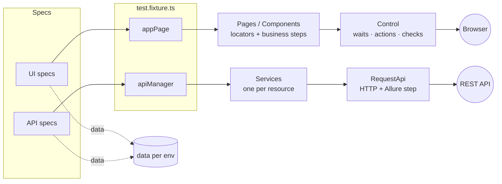

# UI + API Automation Testing Framework

[](https://github.com/ThuongNguyen1992/ui-api-automation-testing/actions/workflows/e2e.yml)
[](https://thuongnguyen1992.github.io/ui-api-automation-testing/)


A production-style test automation framework for **web UI and REST APIs**, built with **Playwright + TypeScript**.
It runs against two public demo systems — [Swag Labs](https://www.saucedemo.com) (e-commerce UI) and
[DummyJSON](https://dummyjson.com) (REST API) — and shows the patterns I use on real projects:

- **Layered design** — specs → page objects / components → one base `Control` class; specs → API services → one `RequestApi` client.
- **Assertions that really fail** — every check helper throws a readable error; every Expected Result maps to an assertion (UI · Data · Side effect · Negative).
- **Traceability** — each test carries a **Script ID** tag shared by the test case list, the spec and the report history.
- **Multi-environment** — one switch (`dev | stag | prod`) selects URLs and test data; CI and local runs use the same mechanism.
- **Reporting** — Allure (with trend history) published on GitHub Pages, Playwright HTML / JSON / JUnit, run history in Google Sheets.
- **CI** — GitHub Actions on every push / PR and daily schedule.

📊 **Live report:** https://thuongnguyen1992.github.io/ui-api-automation-testing/ · 🗂 **Report history:** [Google Sheet](https://docs.google.com/spreadsheets/d/1rW8dShKksqNqkV5hkODPHexFWYgZ0Xaopb4f32fviTM/edit?gid=732867072#gid=732867072) · 📋 **Test cases:** [docs/test-cases.md](docs/test-cases.md) (37 cases: 24 UI, 13 API)

-------------------------------------

## 📋 Table of Contents

1. [Tech Stack](#1-tech-stack)
2. [Quick Setup](#2-quick-setup)
3. [Project Structure](#3-project-structure)
4. [Architecture](#4-architecture)
5. [Naming Conventions](#5-naming-conventions)
6. [Writing Tests](#6-writing-tests)
7. [Configuration](#7-configuration)
8. [Running Tests](#8-running-tests)
9. [Reports](#9-reports)
10. [Report History (Google Sheets)](#10-report-history-google-sheets)
11. [CI/CD Pipeline](#11-cicd-pipeline)

-------------------------------------

## 1. Tech Stack

| Area | Tools |
| --- | --- |
| Test runner | Playwright Test (UI + `APIRequestContext` for API) |
| Language | TypeScript (strict), path aliases |
| Reporting | Allure (trend history), Playwright HTML, JSON, JUnit |
| Report history | Google Sheets API |
| CI | GitHub Actions → Allure on GitHub Pages |
| Requirements | Node.js ≥ 20, Java 11+ (only to build the Allure report locally) |

-------------------------------------

## 2. Quick Setup

```bash
git clone https://github.com/ThuongNguyen1992/ui-api-automation-testing.git
cd ui-api-automation-testing
npm ci
npx playwright install chromium

npm test                 # all UI + API tests (headless)
npm run report:allure    # open the Allure report of the last run
```

No account or secret is needed — the demo systems are public.

-------------------------------------

## 3. Project Structure

```
config/
├── config.ts                 # local defaults: env, browser, headless, workers, retries, Allure
├── urls.ts                   # hosts per environment (dev | stag | prod)
├── consts.ts                 # report / auth-state paths
└── set-env-ci.js             # writes .env.ci → CI runner for the chosen environment
src/
├── core/                     # framework — no business knowledge
│   ├── ui/control.ts         # Control: base class of every page / component (waits, actions, checks)
│   ├── api/
│   │   ├── client/request-api.ts      # RequestApi: one HTTP client, Allure step per call
│   │   ├── assertions/                # ApiStatusAssert, expectShape / expectEachShape (response contract)
│   │   ├── headers/headers-api.ts     # JSON + Bearer / Cookie headers
│   │   └── auth/get-token.ts          # API token, logged in once per worker
│   ├── fixtures/test.fixture.ts       # test + expect + appPage + apiManager
│   ├── setup/                # global setup, login-once setup project, end reporter
│   ├── reporting/            # run summary → report history (Google Sheets)
│   ├── logging/ utils/       # logger, dynamic env, file helpers
├── page-objects/
│   ├── app-pages.ts          # registry → appPage.<Name> in specs
│   ├── pages/<domain>/       # one class per page          (login.page.ts, checkout.page.ts …)
│   └── components/common/    # UI shared by many pages     (header.component.ts)
├── api/
│   ├── api-manager.ts        # registry → apiManager.<service> in specs
│   └── services/<domain>/    # one class per API resource (product.service.ts …)
├── data/
│   ├── ui/{dev,stag,prod}/test-data.ts   # UI data per environment
│   └── api/{dev,stag,prod}/api-data.ts   # API data per environment
└── tests/
    ├── ui/<domain>/*.spec.ts # auth · inventory · cart · checkout — one Playwright project per domain
    └── api/<domain>/*.spec.ts
docs/test-cases.md            # test case inventory (Script ID ↔ spec ↔ report)
.github/workflows/e2e.yml     # CI pipeline
```

-------------------------------------

## 4. Architecture



Layer rules:

- **Specs** only call `appPage.<Page>.<method>()` / `apiManager.<service>.<method>()`, read data from `@data/...` and assert. No locators, no `page.*`, no hard-coded data.
- **Pages / components** hold the locators and one method per user action. A page never calls another page — multi-page flows live in `CommonFlowPage` (`loginAs`, `checkoutWithCustomer`).
- **Control** is the only place that talks to Playwright's `Page`: every action waits first, every check throws a readable `❌ [ERR] …` message.
- **Services** build the request (URL, headers, token) and return a typed `ApiResult<T>`; specs never call `fetch` / `request` directly.

-------------------------------------

## 5. Naming Conventions

| Item | Convention | Example |
| --- | --- | --- |
| Page / component | `<name>.page.ts` / `<name>.component.ts`, class + suffix | `checkout.page.ts` → `CheckoutPage` |
| API service | `<name>.service.ts`, singular | `product.service.ts` → `ProductService` |
| Spec | `<action>-<object>.spec.ts` | `sort-products.spec.ts` |
| Method | verb first: `open…`, `click…`, `input…`, `select…`, `is…Displayed`, `get…` | `clickAddToCart(name)`, `getCartBadgeCount()` |
| Locator | `UPPER_SNAKE_CASE` XPath constant, prefixed by element type | `BUTTON_CHECKOUT`, `FIELD_POSTAL_CODE`, `LIST_PRODUCT_NAME` |
| Test title | `<Feature> - <Action> - <Expected>` | `Cart - Reload the page - Cart content is kept` |
| Script ID | `<MODULE>-<FEATURE>-<NNN>` tag on the test | `@AUTH-LOGIN-003`, `@CHK-001`, `@API-PRD-004` |

**Locators** — taken from the real DOM, never by position (`[1]`, `nth`, `first()`): exact attributes (`@data-test="…"`) or exact text,
and a `%s` placeholder for values that change (product name):

```ts
const CARD_PRODUCT = '//div[@data-test="inventory-item"][.//div[@data-test="inventory-item-name" and normalize-space()="%s"]]'
const BUTTON_IN_CARD = `${CARD_PRODUCT}//button[normalize-space()="%s"]`

async clickAddToCart(productName: string) {
    await this._click_element(await this._generate_dynamic_locator(BUTTON_IN_CARD, [productName, 'Add to cart']))
}
```

**Tags** — `@<level>` + `@<module>` on the describe (`@regression`, `@cart`), `@<Script ID>` + optional `@smoke` / `@e2e` on the test.

-------------------------------------

## 6. Writing Tests

### Waits — every action waits first (`src/core/ui/control.ts`)

| Wait | Waits for (default 9 s) |
| --- | --- |
| `_wait_for_element_displayed` | element visible |
| `_wait_for_element_disappear` | element hidden / removed |
| `_wait_for_element_exist` | element in the DOM (hidden inputs, lazy content) |
| `_wait_for_element_clickable` | visible + enabled + scrolled into view |

Click / fill / select wait for *clickable*, getters wait for *displayed*. A wait that times out **fails the step right there** with
`[ERR] Wait for …` — it never returns `false` and lets the test continue. No fixed sleeps.

### Checks

| Need | Use |
| --- | --- |
| Element must be displayed / gone | `_verify_element_visible` / `_verify_element_not_visible` (page method `is…Displayed` / `is…NotDisplayed`) |
| Button enabled / disabled | `_verify_element_enabled` / `_verify_element_disabled` |
| URL is / is not | `_verify_url` / `_verify_url_not_match` |
| "A **or** B" outcome | `_wait_for_any({ a, b })` → returns which one appeared (fails if none) |
| Optional UI (branch on it) | `_is_element_displayed` → `true` / `false`, never fails |
| Value | `expect(await appPage.X.get…(), '<what it means>').toBe(expected)` — always with a message |

Never wrap `expect` / waits in `try/catch` to keep going — a real bug keeps the test **red**.

### Expected Results → 4 oracle types

Every Expected Result needs an assertion that fails when the behaviour is wrong:
**UI** (what the user sees) · **Data** (re-read after reload / from the API, not the optimistic UI) · **Side effect** (cart emptied, session ended) · **Negative** (what must not happen).

```ts
test('Checkout - Buy 2 products - Totals are correct and the order is completed', { tag: ['@CHK-001', '@smoke', '@e2e'] }, async ({ appPage }) => {
    const prices = [await appPage.InventoryPage.getProductPrice(picked[0]), await appPage.InventoryPage.getProductPrice(picked[1])]
    await appPage.CommonFlowPage.addProductsToCart(picked)
    await appPage.CommonFlowPage.checkoutWithCustomer(checkout.customer)

    const itemTotal = roundCents(prices[0] + prices[1])
    const tax = roundCents(itemTotal * checkout.tax_rate)
    expect(await appPage.CheckoutPage.getItemTotal(), 'Item total').toBe(itemTotal)          // Data
    expect(await appPage.CheckoutPage.getTotal(), 'Total').toBe(roundCents(itemTotal + tax))

    await appPage.CheckoutPage.clickFinish()
    expect(await appPage.CheckoutPage.getCompleteHeader(), 'Confirmation').toBe(checkout.complete_header) // UI
    await appPage.HeaderComponent.isCartBadgeNotDisplayed()                                   // Side effect
})
```

### API tests — status · contract · data · negative

```ts
test('GET /products - limit + skip - Returns that page of the catalog', { tag: ['@API-PRD-001', '@smoke'] }, async ({ apiManager }) => {
    const res = await apiManager.products.getProducts(limit, skip)
    ApiStatusAssert.ok(res)                                   // status (message includes the body on failure)
    expectEachShape(res.data.products, PRODUCT, 'product')    // contract: every field exists with the right type
    expect(res.data.products.map((p) => p.id), 'Ids follow the skip').toEqual([11, 12, 13, 14, 15])
})
```

### Adding a test

```
src/page-objects/pages/<domain>/xxx.page.ts   → class XxxPage extends Control (locators + methods)
src/page-objects/app-pages.ts                 → register XxxPage (import · type · instance)
src/data/ui/stag/test-data.ts                 → data (override in dev / prod only when it differs)
src/tests/ui/<domain>/<action>-<object>.spec.ts
docs/test-cases.md                            → add the row with its Script ID
```

-------------------------------------

## 7. Configuration

### config/config.ts — local defaults

```ts
export const CONFIG = {
  env: 'stag',          // dev | stag | prod
  browser: 'chrome',    // chrome | firefox | safari
  headless: true,
  maxInstances: 4,      // parallel workers
  retryFails: 0,
  clearAllureResultFolder: true,
  allure_report: true,  // build the Allure report at the end of a local run
}
```

### Dynamic environment (`src/core/utils/dynamic-env.util.ts`)

The run settings are resolved in this order — first match wins:

1. `.env.ci` written by `npm run env:<dev|stag|prod>` → runner `ci`, headless (used by CI).
2. The `env` variable: `env=<runner>_<env>_<browser>_<headless>`, tokens in any order, e.g. `env=local_prod_firefox_false`.
3. `config/config.ts`.

`ENV` then selects the hosts in `config/urls.ts` and the data in `src/data/<ui|api>/<env>/`.

### Playwright projects (`playwright.config.ts`)

| Project | Folder | Notes |
| --- | --- | --- |
| `Setup - UI Auth` | `src/core/setup` | logs in once, saves the session (`reports/.auth`) |
| `UI - Auth` | `src/tests/ui/auth` | starts logged out |
| `UI - Inventory` · `UI - Cart` · `UI - Checkout` | `src/tests/ui/<domain>` | start logged in (session from the setup project) |
| `API - Auth` · `API - Products` · `API - Carts` | `src/tests/api/<domain>` | no browser |

-------------------------------------

## 8. Running Tests

```bash
npm test                                   # everything
npm run test:ui                            # UI projects only
npm run test:api                           # API projects only
npm run test:smoke                         # @smoke only
npx playwright test --grep @CHK-001        # one test case by Script ID
npx playwright test --project="UI - Cart"  # one domain
env=local_stag_chrome_false npx playwright test   # headed, visible browser
npm run env:prod && npx playwright test    # CI-style run on prod (delete .env.ci afterwards)
npm run lint                               # type check
```

-------------------------------------

## 9. Reports

| Report | Where | Open |
| --- | --- | --- |
| Allure (steps, screenshots, video, trace, trend) | `reports/allure-report` | `npm run report:allure` · CI: GitHub Pages |
| Playwright HTML | `reports/html-report` | `npm run report:html` · CI: build artifact |
| JSON / JUnit | `reports/json`, `reports/xml` | input for the report history and other CI tools |

Every API call is an Allure step (`POST https://…/auth/login`), and failed UI tests keep their screenshot, video and trace.

-------------------------------------

## 10. Report History (Google Sheets)

🗂 **Report history:** https://docs.google.com/spreadsheets/d/1rW8dShKksqNqkV5hkODPHexFWYgZ0Xaopb4f32fviTM/edit?gid=732867072#gid=732867072

Every run is logged by `npm run report:history` (`src/core/reporting/google/report-history.js`), from `reports/json/results.json`:

| Tab | One row per | Columns |
| --- | --- | --- |
| **Execution History** | run | No · Date · Test Type · Environment · Total · Pass · Fail · Skip · Flaky · Pass Rate · Duration · Report link |
| **Failed Tests** | failed test of a run | Date · Environment · Script ID · Test Case · Project · Error |

The Script ID links a failed row back to the spec tag and to [docs/test-cases.md](docs/test-cases.md).

-------------------------------------

## 11. CI/CD Pipeline

`.github/workflows/e2e.yml` — on push / pull request to `main`, every day at 08:00 (UTC+7), or manually (choose the environment and a tag):

1. Install, type check, select the environment (`npm run env:<env>`).
2. Run all tests (2 workers, 1 retry) — the job keeps going so the report is always published, then fails if any test failed.
3. Restore the Allure history from the published report → generate the report with its **Trend**.
4. Publish the Allure report to **GitHub Pages**, upload the Playwright report as an artifact.
5. Write the run to the report history (Google Sheets).

-------------------------------------

**Author:** Thuong Nguyen — QA Automation Engineer · MIT License
