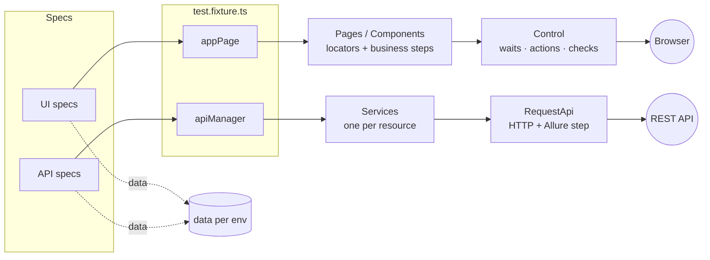
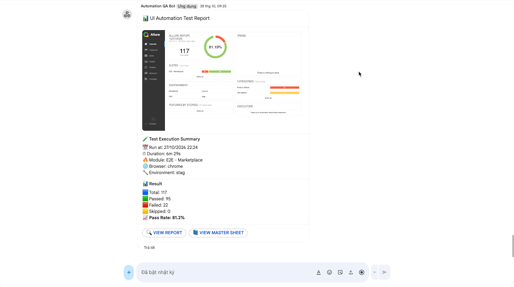
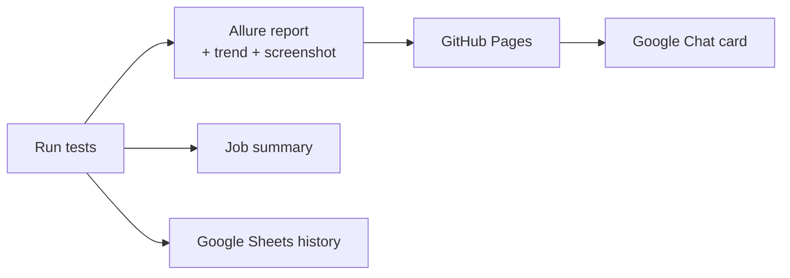

# UI + API Automation Testing Framework

[](https://github.com/ThuongNguyen1992/ui-api-automation-testing/actions/workflows/github-ci.yml)
[](https://github.com/ThuongNguyen1992/ui-api-automation-testing/actions/workflows/performance.yml)
[](https://thuongnguyen1992.github.io/ui-api-automation-testing/)


A production-style test automation framework for **web UI and REST APIs**, built with **Playwright + TypeScript**.
It runs against two public demo systems — [Swag Labs](https://www.saucedemo.com) (e-commerce UI) and
[DummyJSON](https://dummyjson.com) (REST API) — and shows the patterns I use on real projects:

- **Layered design** — specs → page objects / components → one base `Control` class; specs → API services → one `RequestApi` client.
- **Assertions that really fail** — every check helper throws a readable error; every Expected Result maps to an assertion (UI · Data · Side effect · Negative).
- **Traceability** — each test carries a **Script ID** tag shared by the test case list, the spec and the report history.
- **Multi-environment** — one switch (`dev | stag | prod`) selects URLs and test data; CI and local runs use the same mechanism.
- **Reporting** — Allure (with trend history) published on GitHub Pages, a results table on every CI run, a Google Chat card per run, Playwright HTML / JSON / JUnit, run history in Google Sheets.
- **Performance** — k6 load scenarios with pass / fail thresholds, in their own CI workflow.
- **AI-assisted QA** — Claude Code skills that turn test cases into automation, write API tests and analyze failures, following the same conventions.
- **CI** — GitHub Actions on every push / PR and daily schedule.

> **About this project** — a showcase of the framework I build and run on real projects, rewritten against public demo
> systems because client code cannot be published. The structure (domains, projects, data, report channels) is meant to be
> adapted to each product and team; the conventions — layers, locator rules, Script ID traceability, assertions that really fail — stay the same.

📊 **Live report:** https://thuongnguyen1992.github.io/ui-api-automation-testing/ · 🗂 **Report history:** [Google Sheet](https://docs.google.com/spreadsheets/d/1rW8dShKksqNqkV5hkODPHexFWYgZ0Xaopb4f32fviTM/edit?gid=732867072#gid=732867072) · 📋 **Test cases:** [docs/test-cases.md](docs/test-cases.md) (37 cases: 24 UI, 13 API)

-------------------------------------

## 📋 Table of Contents

1. [Tech Stack](#1-tech-stack)
2. [Quick Setup](#2-quick-setup)
3. [Project Structure](#3-project-structure)
4. [Architecture](#4-architecture)
5. [Naming Conventions](#5-naming-conventions)
6. [Writing Tests](#6-writing-tests)
7. [Configuration](#7-configuration)
8. [Running Tests](#8-running-tests)
9. [Reports](#9-reports)
10. [Report History (Google Sheets)](#10-report-history-google-sheets)
11. [CI/CD Pipeline](#11-cicd-pipeline)
12. [Performance Testing (k6)](#12-performance-testing-k6)
13. [AI-assisted QA (Claude Code skills)](#13-ai-assisted-qa-claude-code-skills)
14. [Husky Git Hooks & Editor](#14-husky-git-hooks--editor)

-------------------------------------

## 1. Tech Stack

| Area | Tools |
| --- | --- |
| Test runner | Playwright Test (UI + `APIRequestContext` for API) |
| Language | TypeScript (strict), path aliases |
| Reporting | Allure (trend history), Playwright HTML, JSON, JUnit |
| Report history | Google Sheets API |
| Notification | Google Chat webhook (card with the report screenshot) |
| Performance | k6 |
| AI assistant | Claude Code — project skills in `.claude/skills` |
| CI | GitHub Actions → Allure on GitHub Pages |
| Code quality | TypeScript type check, Husky git hooks, Prettier (VS Code) |
| Requirements | Node.js ≥ 20, Java 11+ (only to build the Allure report locally), k6 (only for performance tests) |

-------------------------------------

## 2. Quick Setup

### Step 1: Clone & Install

```bash
git clone https://github.com/ThuongNguyen1992/ui-api-automation-testing.git
cd ui-api-automation-testing
npm ci                              # also installs the Husky git hooks (prepare script)
npx playwright install chromium
brew install k6                     # optional — only for performance tests
```

Open the folder in VS Code and accept the recommended extensions (Playwright, Prettier, Claude Code) — `.vscode/settings.json` sets the formatter.

### Step 2: Configure Environment

- No account or secret is needed — the demo systems are public.
- Default run settings (env, browser, headless, workers, retries, Allure) are in `config/config.ts`.
- Switch them per run with `env=<runner>_<env>_<browser>_<headless>`, or `npm run env:<dev|stag|prod>` (writes `.env.ci`, CI-style) — see [Configuration](#7-configuration).
- Optional integrations (Google Chat card, Google Sheets history): copy `.env.example` to `.env`.

### Step 3: Run First Test

```bash
# Run with static config (config/config.ts)
npm test                                            # all UI + API tests
npx playwright test --grep @AUTH-LOGIN-001          # one test case by Script ID

# Run with dynamic config: env=<runner>_<env>_<browser>_<headless>
#   runner: local | ci · env: dev | stag | prod · browser: chrome | firefox | safari · headless: true | false
env=local_stag_chrome_false npx playwright test --grep @smoke

# Run against another environment with the CI runner (writes .env.ci, headless) — delete .env.ci afterwards
npm run env:prod && npm test; rm .env.ci

# Performance smoke (k6)
npm run k6:smoke

# Open the reports
allure open                              # Allure
npm run report:html                                 # Playwright HTML
```

-------------------------------------

## 3. Project Structure

```
config/
├── config.ts                 # local defaults: env, browser, headless, workers, retries, Allure
├── urls.ts                   # hosts per environment (dev | stag | prod)
├── consts.ts                 # report / auth-state paths
└── set-env-ci.js             # writes .env.ci → CI runner for the chosen environment
src/
├── core/                     # framework — no business knowledge
│   ├── ui/control.ts         # Control: base class of every page / component (waits, actions, checks)
│   ├── api/
│   │   ├── client/request-api.ts      # RequestApi: one HTTP client, Allure step per call
│   │   ├── assertions/                # ApiStatusAssert, expectShape / expectEachShape (response contract)
│   │   ├── headers/headers-api.ts     # JSON + Bearer / Cookie headers
│   │   └── auth/get-token.ts          # API token, logged in once per worker
│   ├── fixtures/test.fixture.ts       # test + expect + appPage + apiManager
│   ├── setup/                # global setup, login-once setup project, end reporter
│   ├── reporting/            # run summary → job summary · Google Chat card · report history · report screenshot
│   ├── logging/ utils/       # logger, dynamic env, file helpers
├── page-objects/
│   ├── app-pages.ts          # registry → appPage.<Name> in specs
│   ├── pages/<domain>/       # one class per page          (login.page.ts, checkout.page.ts …)
│   └── components/common/    # UI shared by many pages     (header.component.ts)
├── api/
│   ├── api-manager.ts        # registry → apiManager.<service> in specs
│   └── services/<domain>/    # one class per API resource (product.service.ts …)
├── data/
│   ├── ui/{dev,stag,prod}/test-data.ts   # UI data per environment
│   └── api/{dev,stag,prod}/api-data.ts   # API data per environment
└── tests/
    ├── ui/<domain>/*.spec.ts # auth · inventory · cart · checkout — one Playwright project per domain
    └── api/<domain>/*.spec.ts
k6/
├── lib/                      # k6 profiles + thresholds, end-of-test summary (JSON + Markdown)
└── scenarios/*.js            # products-api · auth-flow
reports/                      # generated by each run, not committed — see reports/README.md
├── allure-report/            # Allure HTML (+ overview.png)
├── html-report/              # Playwright HTML
├── json/ · xml/              # results.json (input of every report channel) · JUnit
├── test-results/             # screenshot · video · error-context of failed tests
└── k6/                       # k6 summaries
docs/
├── test-cases.md             # test case inventory (Script ID ↔ spec ↔ report)
└── images/                   # README images
.claude/skills/               # Claude Code skills: ui-test-from-cases · api-testing · qa-failure-analyzer
CLAUDE.md                     # project rules for Claude Code
.github/workflows/
├── github-ci.yml             # UI + API tests → reports → Google Chat
└── performance.yml           # k6
.husky/                       # git hooks: pre-commit · pre-push
.vscode/                      # editor settings + recommended extensions
.env.example                  # optional integrations (Google Chat, Google Sheets)
```

-------------------------------------

## 4. Architecture



Layer rules:

- **Specs** only call `appPage.<Page>.<method>()` / `apiManager.<service>.<method>()`, read data from `@data/...` and assert. No locators, no `page.*`, no hard-coded data.
- **Pages / components** hold the locators and one method per user action. A page never calls another page — multi-page flows live in `CommonFlowPage` (`loginAs`, `checkoutWithCustomer`).
- **Control** is the only place that talks to Playwright's `Page`: every action waits first, every check throws a readable `❌ [ERR] …` message.
- **Services** build the request (URL, headers, token) and return a typed `ApiResult<T>`; specs never call `fetch` / `request` directly.

-------------------------------------

## 5. Naming Conventions

| Item | Convention | Example |
| --- | --- | --- |
| Page / component | `<name>.page.ts` / `<name>.component.ts`, class + suffix | `checkout.page.ts` → `CheckoutPage` |
| API service | `<name>.service.ts`, singular | `product.service.ts` → `ProductService` |
| Spec | `<action>-<object>.spec.ts` | `sort-products.spec.ts` |
| Method | verb first: `open…`, `click…`, `input…`, `select…`, `is…Displayed`, `get…` | `clickAddToCart(name)`, `getCartBadgeCount()` |
| Locator | `UPPER_SNAKE_CASE` XPath constant, prefixed by element type | `BUTTON_CHECKOUT`, `FIELD_POSTAL_CODE`, `LIST_PRODUCT_NAME` |
| Test title | `<Feature> - <Action> - <Expected>` | `Cart - Reload the page - Cart content is kept` |
| Script ID | `<MODULE>-<FEATURE>-<NNN>` tag on the test | `@AUTH-LOGIN-003`, `@CHK-001`, `@API-PRD-004` |

**Locators** — taken from the real DOM, never by position (`[1]`, `nth`, `first()`): exact attributes (`@data-test="…"`) or exact text,
and a `%s` placeholder for values that change (product name):

```ts
const CARD_PRODUCT = '//div[@data-test="inventory-item"][.//div[@data-test="inventory-item-name" and normalize-space()="%s"]]'
const BUTTON_IN_CARD = `${CARD_PRODUCT}//button[normalize-space()="%s"]`

async clickAddToCart(productName: string) {
    await this._click_element(await this._generate_dynamic_locator(BUTTON_IN_CARD, [productName, 'Add to cart']))
}
```

**Tags** — `@<level>` + `@<module>` on the describe (`@regression`, `@cart`), `@<Script ID>` + optional `@smoke` / `@e2e` on the test.

-------------------------------------

## 6. Writing Tests

### Waits — every action waits first (`src/core/ui/control.ts`)

| Wait | Waits for (default 9 s) |
| --- | --- |
| `_wait_for_element_displayed` | element visible |
| `_wait_for_element_disappear` | element hidden / removed |
| `_wait_for_element_exist` | element in the DOM (hidden inputs, lazy content) |
| `_wait_for_element_clickable` | visible + enabled + scrolled into view |

Click / fill / select wait for *clickable*, getters wait for *displayed*. A wait that times out **fails the step right there** with
`[ERR] Wait for …` — it never returns `false` and lets the test continue. No fixed sleeps.

### Checks

| Need | Use |
| --- | --- |
| Element must be displayed / gone | `_verify_element_visible` / `_verify_element_not_visible` (page method `is…Displayed` / `is…NotDisplayed`) |
| Button enabled / disabled | `_verify_element_enabled` / `_verify_element_disabled` |
| URL is / is not | `_verify_url` / `_verify_url_not_match` |
| "A **or** B" outcome | `_wait_for_any({ a, b })` → returns which one appeared (fails if none) |
| Optional UI (branch on it) | `_is_element_displayed` → `true` / `false`, never fails |
| Value | `expect(await appPage.X.get…(), '<what it means>').toBe(expected)` — always with a message |

Never wrap `expect` / waits in `try/catch` to keep going — a real bug keeps the test **red**.

### Expected Results → 4 oracle types

Every Expected Result needs an assertion that fails when the behaviour is wrong:
**UI** (what the user sees) · **Data** (re-read after reload / from the API, not the optimistic UI) · **Side effect** (cart emptied, session ended) · **Negative** (what must not happen).

```ts
test('Checkout - Buy 2 products - Totals are correct and the order is completed', { tag: ['@CHK-001', '@smoke', '@e2e'] }, async ({ appPage }) => {
    const prices = [await appPage.InventoryPage.getProductPrice(picked[0]), await appPage.InventoryPage.getProductPrice(picked[1])]
    await appPage.CommonFlowPage.addProductsToCart(picked)
    await appPage.CommonFlowPage.checkoutWithCustomer(checkout.customer)

    const itemTotal = roundCents(prices[0] + prices[1])
    const tax = roundCents(itemTotal * checkout.tax_rate)
    expect(await appPage.CheckoutPage.getItemTotal(), 'Item total').toBe(itemTotal)          // Data
    expect(await appPage.CheckoutPage.getTotal(), 'Total').toBe(roundCents(itemTotal + tax))

    await appPage.CheckoutPage.clickFinish()
    expect(await appPage.CheckoutPage.getCompleteHeader(), 'Confirmation').toBe(checkout.complete_header) // UI
    await appPage.HeaderComponent.isCartBadgeNotDisplayed()                                   // Side effect
})
```

### API tests — status · contract · data · negative

```ts
test('GET /products - limit + skip - Returns that page of the catalog', { tag: ['@API-PRD-001', '@smoke'] }, async ({ apiManager }) => {
    const res = await apiManager.products.getProducts(limit, skip)
    ApiStatusAssert.ok(res)                                   // status (message includes the body on failure)
    expectEachShape(res.data.products, PRODUCT, 'product')    // contract: every field exists with the right type
    expect(res.data.products.map((p) => p.id), 'Ids follow the skip').toEqual([11, 12, 13, 14, 15])
})
```

### Adding a test

```
src/page-objects/pages/<domain>/xxx.page.ts   → class XxxPage extends Control (locators + methods)
src/page-objects/app-pages.ts                 → register XxxPage (import · type · instance)
src/data/ui/stag/test-data.ts                 → data (override in dev / prod only when it differs)
src/tests/ui/<domain>/<action>-<object>.spec.ts
docs/test-cases.md                            → add the row with its Script ID
```

-------------------------------------

## 7. Configuration

### config/config.ts — local defaults

```ts
export const CONFIG = {
  env: 'stag',          // dev | stag | prod
  browser: 'chrome',    // chrome | firefox | safari
  headless: true,
  maxInstances: 4,      // parallel workers
  retryFails: 0,
  clearAllureResultFolder: true,
  allure_report: true,  // build the Allure report at the end of a local run
}
```

### Dynamic environment (`src/core/utils/dynamic-env.util.ts`)

The run settings are resolved in this order — first match wins:

1. `.env.ci` written by `npm run env:<dev|stag|prod>` → runner `ci`, headless (used by CI).
2. The `env` variable: `env=<runner>_<env>_<browser>_<headless>`, tokens in any order, e.g. `env=local_prod_firefox_false`.
3. `config/config.ts`.

`ENV` then selects the hosts in `config/urls.ts` and the data in `src/data/<ui|api>/<env>/`.

### Playwright projects (`playwright.config.ts`)

| Project | Folder | Notes |
| --- | --- | --- |
| `Setup - UI Auth` | `src/core/setup` | logs in once, saves the session (`reports/.auth`) |
| `UI - Auth` | `src/tests/ui/auth` | starts logged out |
| `UI - Inventory` · `UI - Cart` · `UI - Checkout` | `src/tests/ui/<domain>` | start logged in (session from the setup project) |
| `API - Auth` · `API - Products` · `API - Carts` | `src/tests/api/<domain>` | no browser |

-------------------------------------

## 8. Running Tests

| Group | Script | What it runs |
| --- | --- | --- |
| **Quality** | `npm run lint` | TypeScript type check (also run by the Husky hooks) |
| **All** | `npm test` | every UI + API test |
| | `npm run test:ui` / `test:api` | UI projects / API projects only |
| | `npm run test:tag <@tag>` | any tag, e.g. `npm run test:tag @CHK-001` (one test case by Script ID) |
| **By level** | `npm run test:smoke` | `@smoke` — critical path, UI + API |
| | `npm run test:smoke-ui` / `test:smoke-api` | `@smoke` UI only / API only |
| | `npm run test:regression` | `@regression` — the full regression suite |
| | `npm run test:e2e` | `@e2e` — end-to-end purchase flows |
| | `npm run test:smoke:ci` / `test:e2e:ci` | same with 1 worker and 1 retry (CI-style) |
| **By module** | `npm run test:auth` · `test:inventory` · `test:cart` · `test:checkout` | one business module |
| **Debug** | `npm run test:headed` | visible browser |
| | `npm run test:ui-mode` | Playwright UI mode (watch, time-travel) |
| | `npm run test:debug` | Playwright Inspector, step by step |
| | `npm run pw:codegen` | record locators / steps on Swag Labs |
| | `npm run pw:trace <trace.zip>` | open a trace of a failed test |
| **Environment** | `npm run env:dev` · `env:stag` · `env:prod` | write `.env.ci` → CI runner, headless (delete it afterwards) |
| **Reports** | `npm run report:allure` / `report:allure:generate` | open / build the Allure report |
| | `npm run report:html` | open the Playwright HTML report |
| | `npm run report:summary` | last run as a Markdown table (CI job summary) |
| | `npm run report:screenshot` | screenshot of the Allure overview (`overview.png`) |
| | `npm run report:gg-chat -- <reportUrl>` | send the Google Chat card (`--dry-run` to print it) |
| | `npm run report:gg-history -- <reportUrl>` | add the run to the Google Sheets history (`--dry-run` to print it) |
| **Performance** | `npm run k6:smoke` / `k6:load` | every k6 scenario, 1 user 30 s / up to 10 users |
| | `npm run k6:products` · `k6:auth` | one scenario — extra k6 flags after `--`, e.g. `-- -e PROFILE=load` |

Combine any of them with a dynamic environment: `env=local_prod_chrome_false npm run test:cart`.

-------------------------------------

## 9. Reports

| Report | Where | Open |
| --- | --- | --- |
| Allure (steps, screenshots, video, trace, trend) | `reports/allure-report` | `npm run report:allure` · CI: GitHub Pages |
| Playwright HTML | `reports/html-report` | `npm run report:html` · CI: build artifact |
| JSON / JUnit | `reports/json`, `reports/xml` | input for the report channels below and other CI tools |
| Job summary | GitHub Actions run page | totals, result per project, failed tests with Script ID and error — `npm run report:summary` |
| Google Chat card | team space | `npm run report:gg-chat` — see below |

Every API call is an Allure step (`POST https://…/auth/login`), and failed UI tests keep their screenshot, video and trace.

### Run notification in Google Chat

After each CI run, once the report is published, `src/core/reporting/google/google-chat-bot.js` posts a card: a screenshot of the
Allure overview (`npm run report:screenshot`, published with the report), run info (time, duration, module, browser, environment),
the results with the pass rate, the failed tests by Script ID, and buttons to the report and the report history.
One webhook per environment (`GG_CHAT_WEBHOOK_<ENV>`, falling back to `GG_CHAT_WEBHOOK`); with no webhook the step is skipped.
`npm run report:gg-chat -- <reportUrl> --dry-run` prints the card instead of sending it.

Example card from a real project run:

<p align="center">
  
</p>

-------------------------------------

## 10. Report History (Google Sheets)

🗂 **Report history:** https://docs.google.com/spreadsheets/d/1rW8dShKksqNqkV5hkODPHexFWYgZ0Xaopb4f32fviTM/edit?gid=732867072#gid=732867072

Every run is logged by `npm run report:gg-history` (`src/core/reporting/google/report-history.js`), from `reports/json/results.json`:

| Tab | One row per | Columns |
| --- | --- | --- |
| **Execution History** | run | No · Date · Test Type · Environment · Total · Pass · Fail · Skip · Flaky · Pass Rate · Duration · Report link |
| **Failed Tests** | failed test of a run | Date · Environment · Script ID · Test Case · Project · Error |

The Script ID links a failed row back to the spec tag and to [docs/test-cases.md](docs/test-cases.md).

-------------------------------------

## 11. CI/CD Pipeline

`.github/workflows/github-ci.yml` — on push / pull request to `main`, every day at 08:00 (UTC+7), or manually (choose the environment and a tag):

1. Install, type check, select the environment (`npm run env:<env>`).
2. Run all tests (2 workers, 1 retry) — the job keeps going so the report is always published, then fails if any test failed.
3. Restore the Allure history from the published report → generate the report with its **Trend** → screenshot its overview.
4. Write the **job summary** (results table on the run page) and the run to the report history (Google Sheets).
5. Publish the Allure report to **GitHub Pages**, upload the Playwright report as an artifact.
6. Send the **Google Chat** card (after the deploy, so its links and screenshot are live).



`.github/workflows/performance.yml` runs the k6 scenarios every Monday (smoke) or manually (smoke / load) — see section 12.

-------------------------------------

## 12. Performance Testing (k6)

| Scenario | Flow | Endpoint thresholds (p95) |
| --- | --- | --- |
| `k6/scenarios/products-api.js` | list products → open one of them → search | `GET /products`, `GET /products/{id}`, `GET /products/search` < 800 ms |
| `k6/scenarios/auth-flow.js` | log in → call `/auth/me` with the token | `POST /auth/login` < 1.5 s, `GET /auth/me` < 1 s |

| Profile | Load |
| --- | --- |
| `smoke` | 1 virtual user, 30 s — the script and the service work |
| `load` | ramp up to 10 users, hold 1 min, ramp down — normal traffic |

Global thresholds for every scenario: errors < 1 %, checks > 99 %, p95 < 1.5 s. A failed threshold fails the run (exit code 99) and the CI job.
Each run writes `reports/k6/<scenario>.json` and a Markdown table (shown in the job summary):

```
k6 products-api (smoke) — PASSED
  requests 51 · failed 0.00% · checks 100.00%
  duration avg 271 ms · p(95) 337 ms · max 447 ms
  ✓ http_req_duration{name:GET /products} p(95)<800
  ✓ http_req_failed rate<0.01
```

The target is a public demo API, so the load stays small; point `BASE_URL` at your own environment for real load tests
(`k6 run -e PROFILE=load -e BASE_URL=https://… k6/scenarios/products-api.js`).

-------------------------------------

## 13. AI-assisted QA (Claude Code skills)

The repo ships [Claude Code](https://claude.com/claude-code) skills that encode the conventions above, so AI-written tests look like hand-written ones
and are checked the same way. Rules for the assistant are in [CLAUDE.md](CLAUDE.md).

| Skill | Input | What it does |
| --- | --- | --- |
| [`/ui-test-from-cases`](.claude/skills/ui-test-from-cases/SKILL.md) | test case table (ID, steps, expected) | normalizes the steps, reuses page-object methods (`scripts/list-steps.mjs`), writes locators from the real DOM, maps every Expected Result to an assertion, runs the tests |
| [`/api-testing`](.claude/skills/api-testing/SKILL.md) | endpoint / cURL / API docs | adds the typed service method and specs with status + contract + data + negative checks |
| [`/qa-failure-analyzer`](.claude/skills/qa-failure-analyzer/SKILL.md) | failed run / CI log | lists failures with step and evidence (`scripts/list-failures.mjs`), classifies the root cause, fixes the right layer — a real product bug keeps the test red |

Guardrails shared by all skills: no locators or data in specs, no positional locators, no sleeps to hide a failure, never weaken an assertion to get green, never report a result that was not run.

-------------------------------------

## 14. Husky Git Hooks & Editor

| Hook | Checks |
| --- | --- |
| **pre-commit** | blocks the commit if your branch is behind `origin` (pull --rebase first), then runs `npm run lint` |
| **pre-push** | runs `npm run lint` and aborts the push on failure |

Hooks are installed automatically by `npm ci` / `npm install` (`prepare` script).

**VS Code** — `.vscode/settings.json`: format on save with Prettier (no semicolons, single quotes, 120 columns), TypeScript formatter for `.ts`;
`.vscode/extensions.json` recommends Playwright Test, Prettier and Claude Code.

-------------------------------------

**Author:** Thuong Nguyen — QA Automation Engineer · MIT License
